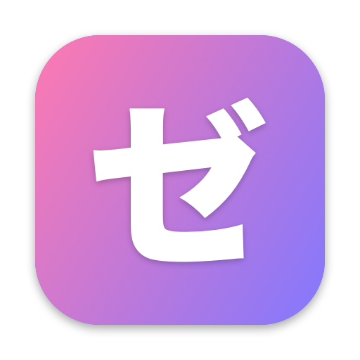

<p align="center"></p>

# zenteru · 젠테루 · ゼンテール

A macOS terminal with first-class 全角 (zenkaku / full-width) support,
rendered with Metal, with Chrome-style tabs and an iTerm2-style Python
plugin API. The name is [zencode](https://github.com/team-mirae/zencode) +
テル, the Japanese reading of "terminal".

> [!NOTE]
> zenteru is a dogfooded, rolling, bleeding-edge release: we use it every
> day and ship straight from `main`. Things will break, so keep
> [iTerm2](https://iterm2.com) (or Terminal.app) installed just in case.

- **Zenkaku from day one.** 한글, 日本語 and other wide characters take
  two cells everywhere: in the grid, the cursor, reflow on resize,
  selection, IME preedit and every piece of UI chrome. 全角スペース is
  tinted so you can see it.
- **Sino characters in your region's forms.** `SINO_DISPLAY=JA` (the
  default, 新字体) picks Hiragino; `KO` picks Apple SD Gothic Neo; `SG`
  picks PingFang SC. Everything else falls back through the macOS font
  cascade.
- **A monospaced font that covers CJK.** SF Mono for Latin, with CJK
  glyphs centred in exactly two cells. `ZENTERU_FONT`,
  `ZENTERU_CJK_FONT` and `ZENTERU_FONT_SIZE` override the defaults.
- **Natural text editing.**
  - ⌥←/⌥→/⌥⌫/⌥⌦ move and delete by zencode **letterblocks**:
    한국어를 is 한국어 | 를, and あなたのギター is あなたの | ギター.
  - ⌘←/⌘→/⌘⌫ work on the whole line.
  - ⌘↑/⌘↓ jump between prompts.
  - Double-click selects a letterblock.
- **Tabs, Chrome-style.**
  - A single session still shows a tab.
  - Drag a tab to reorder it, drag it out to make a new window, or drop it
    on another window's tab bar to merge.
  - Dragging the only tab moves the window.
  - The whole top bar uses the zencode gradient, and the window corners are
    square.
- **Black Magic.** Type `@` at an empty prompt (local or over ssh), or in
  vim's normal mode, or press ⌘⇧P. Known commands run (`@new-tab`,
  `@line-numbers`, plugin commands), and anything else goes to the agentic
  helper (hmxv): `@why did -3 fail?`. `@help` and `@hmxv` belong to hmxv,
  and `@@` types a literal `@`.
- **Line references.** In shell mode a gutter shows ゼロ, -1, -2 … counting
  up from the cursor's line, plus a 3-character code per line taken from a
  UUIDv7 stamped when the line arrived. You can cite either one to hmxv or
  to plugins.
  While another program has the terminal (Claude Code, vim, a build), the
  gutter shows zencode-gradient rain instead, which becomes a still gradient
  with Reduce Motion on. A 24-hour clock and the date sit at the bottom.
- **Password fields you can't miss.**
  - When the tty turns echo off (sudo, ssh, `read -s`), the input shows a
    gradient frame with one ● per key.
  - If you type a password you used recently into a normal field, a red
    banner appears and Enter is held back.
  - A prompt that asks for a password while echo is still on gets a
    warning.
- **Touch ID / YubiKey for sudo.** `zenteru sudo-auth [--yubikey]` sets up
  `/etc/pam.d/sudo_local` (`pam_tid`, `pam_u2f`) after showing the file
  and asking first.
- **Minimal dependencies.**
  - The core (`crates/zenteru-term`) is self-engineered Rust: VT parser,
    grid, pty, JSON and the API server.
  - Text logic (`crates/zenteru-text`) is shared with zencode.
  - The app itself depends only on the objc2 bindings for AppKit, Metal,
    CoreText and CoreGraphics.

## Install

```sh
curl -fsSL https://raw.githubusercontent.com/team-mirae/zenteru/main/install.sh | sh
```

This installs the latest release's universal `zenteru.app` into
`/Applications` (or `~/Applications` when `/Applications` isn't writable),
verifies its SHA-256 checksum and code signature, and links the `zenteru`
command into `~/.local/bin`. No sudo is needed. Set the variables on the
`sh` side of the pipe to change where things go:

```sh
curl -fsSL https://raw.githubusercontent.com/team-mirae/zenteru/main/install.sh | ZENTERU_VERSION=v0.1.0 ZENTERU_APP_DIR=~/Applications sh
```

`zenteru` opens the app (or focuses it), and `zenteru sudo-auth` turns on
Touch ID or YubiKey for sudo. Builds are on the
[releases page](https://github.com/team-mirae/zenteru/releases). macOS 13
or later is required.

## Plugins

Plugins are Python 3.11+, use only the standard library, and talk to
zenteru over a Unix socket. The protocol is in
[docs/PROTOCOL.md](docs/PROTOCOL.md) and the Python API in
[docs/PYTHON_API.md](docs/PYTHON_API.md). The API mirrors iTerm2's, and a
shim at `python/iterm2` lets most iTerm2 scripts run as they are. See
[python/iterm2/README.md](python/iterm2/README.md).

Bundled plugins:

| Plugin | What it does |
|---|---|
| **hmxv** ("help me exit vim") | An AI agent in a side panel. It reads and writes the terminal, has plan and execute modes, and works with Anthropic, OpenAI, Gemini, xAI Grok, OpenRouter or a local OpenAI-compatible server. ⌘⇧H opens it. See [docs/HMXV.md](docs/HMXV.md). |
| **fileholder** | Holds dropped or pasted screenshots and files in a per-launch 0700 directory that is removed when zenteru quits, and types their paths. Claude Code can use a screenshot without it ever being saved. |
| **setenvvar** | Session environment variables that apply to every command you type, but never to the prompt's own environment, your shell history, or commands sent by plugins. |
| **complete** | Tab completion. Off by default: Tab goes to your shell as usual. You can turn on a ranked menu, and the JIS Korean IME integration, which merges IME readings with shell candidates. See [docs/IME_CONTRACT.md](docs/IME_CONTRACT.md). |

User plugins go in `~/Library/Application Support/zenteru/plugins/<name>/`
(with a `plugin.json`). iTerm2-style scripts go in `…/zenteru/Scripts/AutoLaunch/`.
Plugin logs are written to `~/Library/Logs/zenteru/`.

## Build and run

```sh
cargo run -p zenteru-app          # straight from the source tree
scripts/bundle.sh                 # dist/zenteru.app, signed with your Apple Development identity
cargo test --workspace            # Rust tests (including a real zsh end-to-end test)
python3 -m unittest discover -s python/tests
python3 -m unittest discover -s plugins/hmxv/tests
python3 -m unittest discover -s plugins/complete/tests
```

Ready-made run configurations are included for VS Code (`.vscode/`, using
CodeLLDB) and IntelliJ / RustRover (`.run/`). Running unbundled works
because resources are found in the source tree.
`ZENTERU_RESOURCES` overrides that location, and `ZENTERU_PYTHON` picks
the Python used for plugins.

Shell integration loads automatically for zsh and bash. It is in
[shell/](shell/) and adds OSC 133/633/7 marks, the setenvvar hooks and
completion capture.

## Layout

```
crates/zenteru-text   letterblocks, widths (vendored from zencode @ 815657f), palette, Sino display, secret heuristics
crates/zenteru-term   VT parser, grid + reflow, pty, key/mouse encoding, sessions, JSON, plugin API server
crates/zenteru-app    AppKit + Metal + CoreText app (tabs, panels, IME, overlays)
python/zenteru        plugin client package       python/iterm2   iTerm2 compatibility shim
plugins/              hmxv, fileholder, setenvvar, complete
shell/                zsh / bash integration
docs/                 PROTOCOL, PYTHON_API, HMXV, IME_CONTRACT
```

## License

MIT © 2026 Mirae Research
